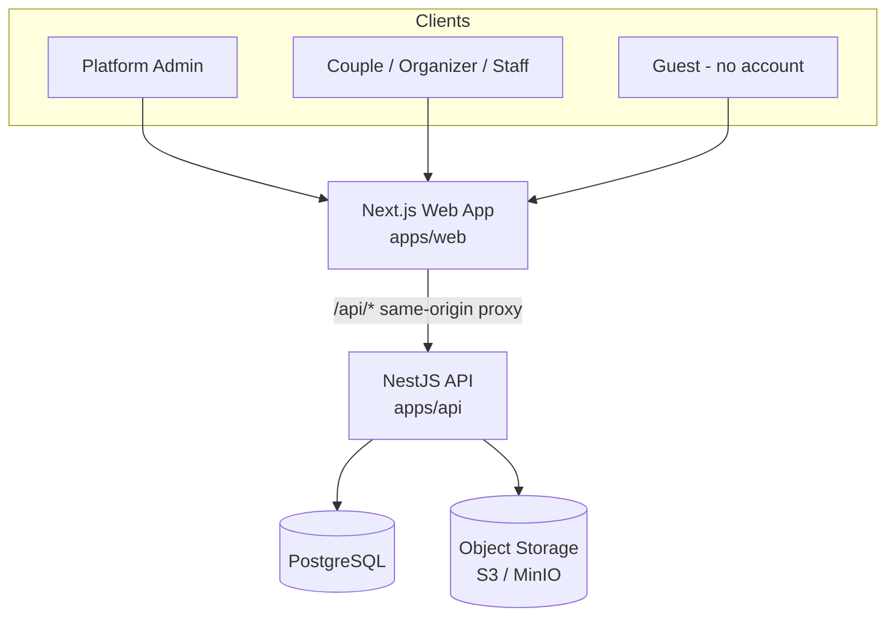
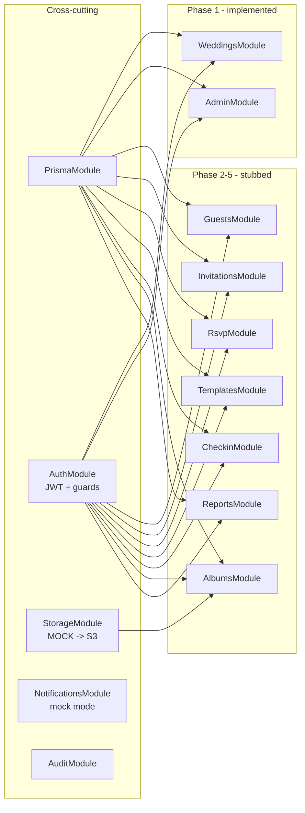
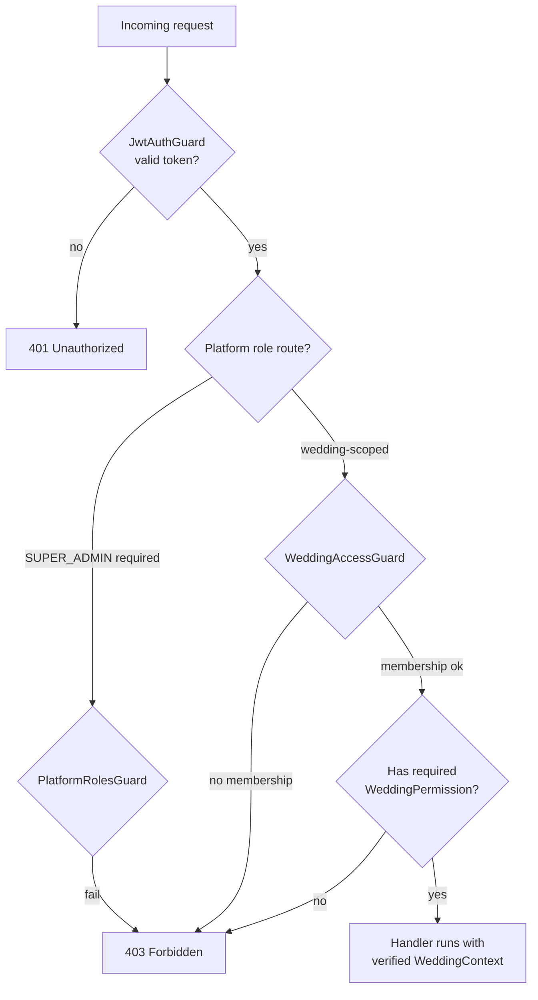
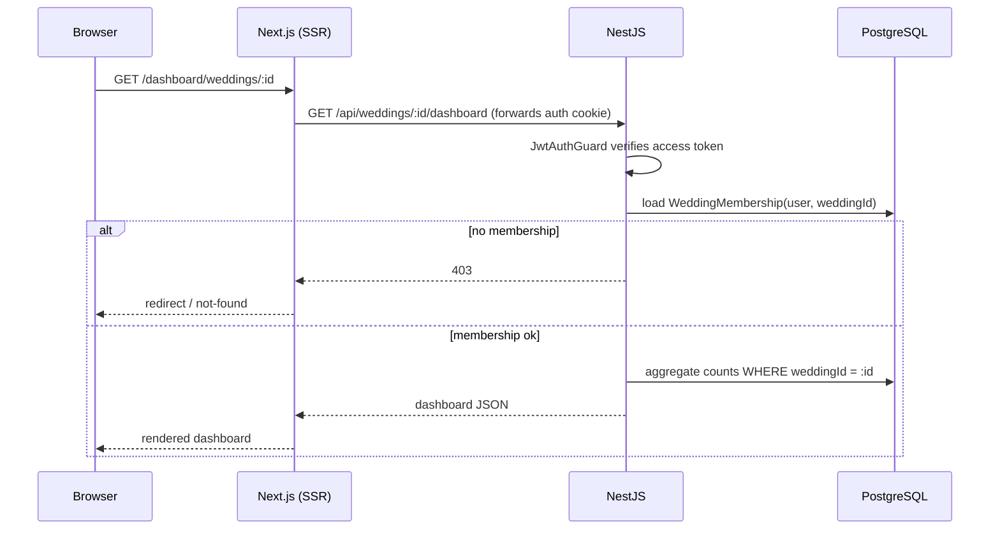
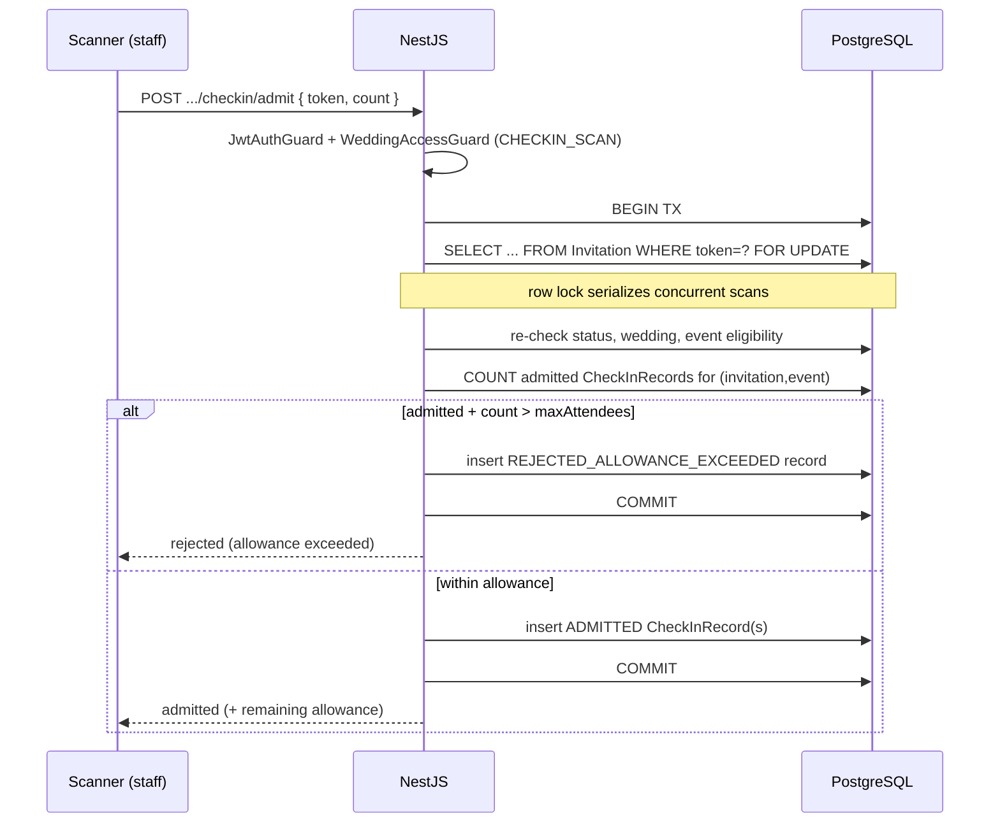

# WedLink — Architecture

This document describes the system design, the access-control model, and the
non-negotiable rules every contributor must preserve. Read it before changing
anything in `apps/api`.

---

## 1. System context

WedLink is one platform serving many independent weddings. Three user-facing
areas share a single backend and database, with logically isolated wedding data.

The three areas from the spec map onto the same stack:

- **Central Administration Portal** — `SUPER_ADMIN` routes (`/api/admin/*`) and
  the `/dashboard/admin` web page.
- **Wedding Management Portal** — authenticated, wedding-scoped routes
  (`/api/weddings/:weddingId/*`) and the `/dashboard/*` web pages.
- **Guest Portal & Scanner** — public, token-based routes (`/api/public/*`) and
  the entrance check-in surface (`/api/weddings/:weddingId/events/:eventId/checkin/*`).

---

## 2. Component view (backend modules)

Every feature module imports `AuthModule` (for `JwtService` + guards) and uses
the global `PrismaModule`. `StorageModule`, `NotificationsModule`, and
`AuditModule` are `@Global` and injectable anywhere.

---

## 3. Access-control model

Two independent layers combine to authorize every request.

- **Platform roles** (`User.platformRole`): `SUPER_ADMIN`, `USER`.
- **Wedding roles** (`WeddingMembership.role`): `OWNER`, `ORGANIZER`,
  `ENTRANCE_STAFF`, `PHOTOGRAPHER`.
- **Permissions** (`WeddingMembership.permissions[]`): fine-grained. An `OWNER`
  implicitly holds all permissions; others hold only what the owner grants.
  Defined once in `packages/shared/src/roles.ts` and used by both API and web.
- **Guests** have no account; they act through unguessable opaque tokens.

See `apps/api/src/auth/` for the guard implementations and
`CONTRIBUTING.md` for how to apply them.

---

## 4. The isolation invariant (most important rule)

> **The backend never trusts a `weddingId` supplied by the client to grant
> access.** For every wedding-scoped request, `WeddingAccessGuard` loads the
> authenticated user's `WeddingMembership` for that wedding from the database
> and denies the request if none exists.

Consequences every contributor must uphold:

1. Wedding-scoped controllers use the path `weddings/:weddingId/...` and apply
   `@UseGuards(JwtAuthGuard, WeddingAccessGuard)`.
2. Every wedding-owned Prisma query filters by `weddingId`.
3. When mutating a child record (guest, invitation, media), assert its
   `weddingId` matches the verified context before writing (defense in depth
   against ID tampering).
4. `SUPER_ADMIN` is the only cross-wedding principal, and only through the
   guard's explicit allowance.

This invariant is what satisfies spec §4, §13, and acceptance criteria #2–#6.

---

## 5. Request flow — authenticated wedding dashboard

---

## 6. Request flow — QR check-in (concurrency-safe)

This is the most correctness-sensitive flow (spec §8.4; test Scenarios 5–7).
The admission MUST be serialized so simultaneous scans never exceed the
invitation's attendee allowance.

The implementation skeleton with the exact `$queryRaw ... FOR UPDATE` approach
is in `apps/api/src/checkin/checkin.service.ts`.

---

## 7. Technology choices

| Concern | Choice | Why |
|---|---|---|
| Frontend | Next.js 15 App Router | SSR for auth-gated pages, same-origin API proxy simplifies cookies |
| Backend | NestJS 10 | Module/guard/DI model maps cleanly onto the access-control design |
| ORM | Prisma 6 | Typed queries, versioned migrations, transactions for concurrency safety |
| DB | PostgreSQL 16 | Relational integrity, row locking, (optional) row-level security |
| Auth | JWT (httpOnly cookies) + bcrypt | Stateless access + rotating refresh tokens, no secrets in the browser |
| Storage | S3-compatible (MinIO dev) | Private media + signed URLs; never large binaries in Postgres |
| Monorepo | pnpm workspaces + Turborepo | Shared types in one place, coordinated builds |

See `docs/DATABASE.md` for the data model and `docs/BUILD-GUIDE.md` for the
phase-by-phase implementation plan.
