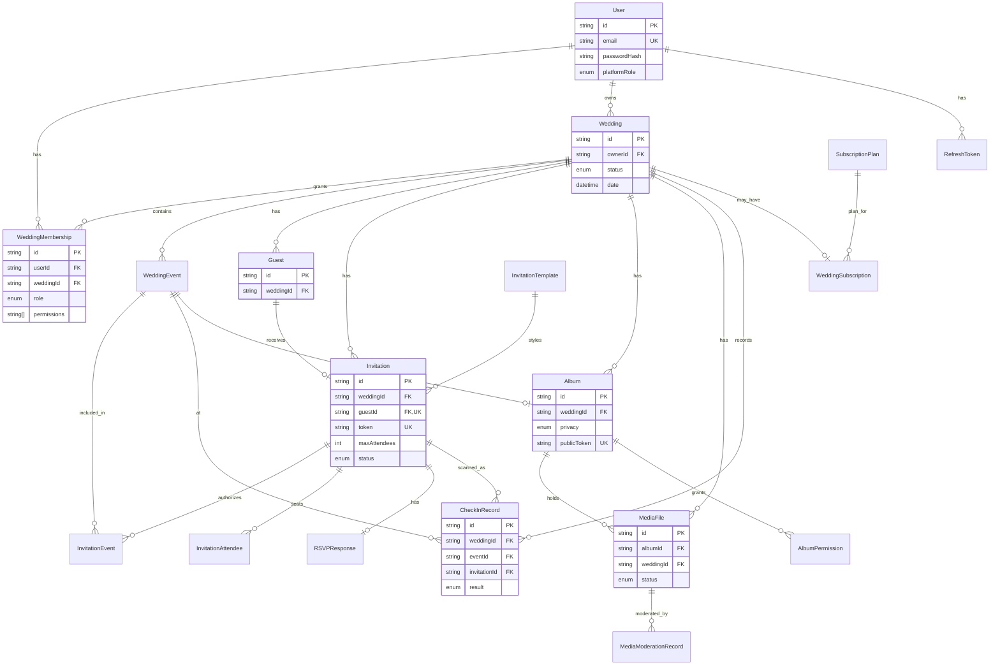

# WedLink — Database

Source of truth: `apps/api/prisma/schema.prisma`. This document explains the
data model, the relationships, and the rules the schema enforces. Regenerate
your understanding from the schema if the two ever disagree.

- Engine: PostgreSQL 16
- ORM: Prisma 6 (versioned migrations in `apps/api/prisma/migrations`)
- IDs: `cuid()` strings
- Timestamps: `createdAt` / `updatedAt` on mutable entities

---

## Entity-relationship diagram



> The ERD omits some scalar columns for readability. The full field list is in
> `schema.prisma`.

---

## Relationship notes

- **User ↔ Wedding** is many-to-many through **WeddingMembership**, which also
  carries the per-wedding `role` and `permissions`. `WeddingMembership` has a
  unique constraint on `(userId, weddingId)` — a user has at most one membership
  per wedding. `Wedding.ownerId` additionally records the creating owner.
- **Guest ↔ Invitation** is one-to-one (`Invitation.guestId` is unique). An
  invitation may be `INDIVIDUAL` or `GROUP`.
- **Invitation ↔ WeddingEvent** is many-to-many through **InvitationEvent** —
  this is how event-specific access works. An invitation only authorizes the
  events it is linked to (unless `WeddingEvent.openToAllGuests`).
- **InvitationAttendee** pre-seats a group invitation up to `maxAttendees`.
- **RSVPResponse** is one-to-one with an invitation; `confirmedCount` must never
  exceed `Invitation.maxAttendees` (enforced in application logic).
- **CheckInRecord** is append-only. It references wedding, event, invitation,
  and staff user, and stores a `result` from the `CheckInResult` enum. It is the
  attendance audit trail — never update in place.
- **Album / MediaFile** — `MediaFile.weddingId` is denormalized (also derivable
  via album) so isolation checks are a single indexed lookup. `Album.privacy`
  is `PRIVATE | INVITED | PUBLIC`; a public album is reached only via its
  unguessable `publicToken`.

---

## Isolation & integrity rules the schema supports

1. **Every wedding-owned record carries `weddingId`** with a foreign key to
   `Wedding`, indexed for fast scoped queries.
2. **Cascading deletes** are set on wedding-owned relations so archiving/removing
   a wedding cleans up its data (see `onDelete: Cascade` in the schema). Treat
   destructive deletes with care — prefer status `ARCHIVED` over hard delete for
   real weddings.
3. **Unique invitation tokens** (`Invitation.token @unique`) back the QR system;
   tokens are opaque and regenerated on compromise.
4. **Append-only attendance** via `CheckInRecord` preserves history and supports
   duplicate-prevention logic.
5. **Optional PostgreSQL row-level security** can be layered on top for defense
   in depth (spec §12); the application-level `WeddingAccessGuard` is the primary
   enforcement today.

---

## Enums

Defined in `schema.prisma` and mirrored in `packages/shared/src/enums.ts`:

`PlatformRole`, `WeddingRole`, `WeddingStatus`, `InvitationType`,
`InvitationStatus`, `RSVPStatus`, `CheckInResult`, `AlbumPrivacy`,
`MediaStatus`, `MediaType`, `GuestLanguage`.

Keep the Prisma enums and the shared TypeScript enums in sync when you change
either.

---

## Migrations & seed

```bash
pnpm db:migrate   # prisma migrate dev — create/apply a migration
pnpm db:seed      # idempotent seed: resets then loads 3 sample weddings
pnpm db:studio    # browse data in Prisma Studio
```

The seed (`apps/api/prisma/seed.ts`) is **idempotent**: it clears all tables in
FK-safe order before inserting, so it can be run repeatedly without creating
duplicates.
